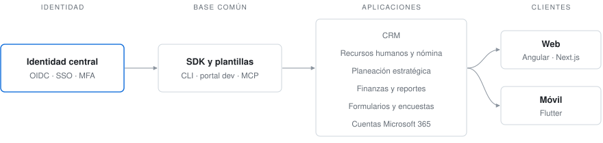
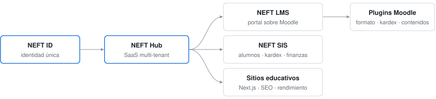

# Neftalí Ruiz

**Desarrollador Full Stack · Arquitecto de software · Fundador de NEFT**

Plataformas para educación e instituciones: identidad centralizada, SaaS multi-tenant, sistemas administrativos, LMS y apps web y móviles.

---

### Perfil

- Arquitectura y desarrollo de extremo a extremo: backend, frontend, bases de datos, despliegue y documentación.
- Identidad y seguridad: OpenID Connect, SSO, MFA y control de acceso por roles y permisos.
- Liderazgo técnico: estándares, plantillas, SDK y flujos de desarrollo asistidos por IA.

### Plataformas institucionales

Colaboro en un ecosistema de más de 15 aplicaciones que comparten identidad, SDK y plantillas estándar.

### NEFT

Productos propios para escuelas y universidades.

### Stack

  

También: OpenID Connect · SQL Server · Moodle · Socket.io · Microsoft Entra ID · Claude Code · MCP

### GitHub

  
  

  <picture>
    <source media="(prefers-color-scheme: dark)" srcset="https://raw.githubusercontent.com/NeftaliRuiz/neftaliruiz/output/snake-dark.svg"/>
    
  </picture>

---

  <i>"Y todo lo que hagáis, hacedlo de corazón, como para el Señor y no para los hombres."</i> — Colosenses 3:23

